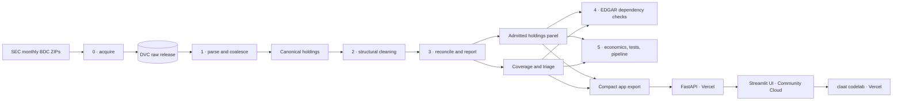

# Project LANTERN — Case Study 2B

DAMG 7245, Fall 2026. Project LANTERN turns the SEC's 2026 Q3 Business
Development Company (BDC) data release into a traceable, reproducible
look-through holdings panel. It reconciles 177 filings to each fund's disclosed
fair value, explains every excluded filing, verifies sampled holdings against
the human-readable filing on EDGAR, and serves the result through a read-only UI
and API.

**Team:** Dany, Julio Sepulveda, and Kahan (`kahan15`)

- Public UI: Streamlit Community Cloud deployment pending
- API: <https://lantern-lab2b.vercel.app>
- API documentation: <https://lantern-lab2b.vercel.app/docs>
- Codelab: <https://lantern-cs2b-codelab.vercel.app>
- DVC remote: [DVC remote access](#dvc-remote-access)

The panel contains investment holdings and deliberately excludes cash and
money-market lines. Coverage is **88 of 177 attempted filings (49.7%)** and
**$234.4B of $556.9B filed fair value (42.1%)**. The remaining filings stay
visible in the coverage and triage reports rather than being forced into the
panel.

## Architecture



The data pipeline and serving layers are independent. `app/` is not a
dependency of `dvc.yaml`; breaking or redeploying the UI does not change the
analytical panel.

## Part-to-code map

| Part | Purpose | Code and configuration | Reports and outputs |
|---|---|---|---|
| 0 | Acquire the three SEC monthly releases and verify hashes | `scripts/acquire.py`, `src/lookthrough/acquire.py`, `src/lookthrough/quarter.py`, `params.yaml`, `data/manifest.json` | `data/raw/` (DVC), `dvc.lock` |
| 1 | Parse SUB/TAG/NUM/SOI, map dimensions, preserve source rows, and coalesce current-period holdings | `scripts/parse.py`, `src/lookthrough/load.py`, `mapping.py`, `holdings.py`, `coalesce.py` | `outputs/canonical/holdings.parquet`, `reports/periods.csv`, `reports/conflicts.csv`, `docs/schema.md` |
| 2 | Apply structural rules for totals, issuer aggregates, and cash lines | `scripts/clean.py`, `src/lookthrough/clean.py` | `outputs/cleaned/holdings.parquet`, `reports/cleaning_log.csv`, `docs/cleaning_log.md`, `tests/test_cleaning_real_release.py` |
| 3 | Reconcile to filed fair value, admit within tolerance, and keep every exclusion visible | `scripts/reconcile.py`, `scripts/report.py`, `src/lookthrough/reconcile.py`, `report.py` | `outputs/panel/holdings.parquet`, `reports/coverage.csv`, `coverage.md`, `coverage.json`, `triage.md` |
| 4 | Compare sampled panel values with the human-readable EDGAR filing and audit issuer-aggregate removals | `scripts/verify_dependency.py`, `tests/test_lookthrough.py` | `reports/spot_check.csv`, `dependency_check.md`, `aggregate_audit.md` |
| 5 | Reproduce the pipeline, test failure modes, measure economics, and serve the result | `dvc.yaml`, `tests/`, `scripts/export_app_data.py`, `app/api/`, `app/web/`, `serve_web.py` | `reports/economics.md`, `reports/tests_that_fail.md`, `reports/app_tests_that_fail.md`, UI/API/codelab |

## Serving layer

The serving architecture has three independent public components:

| Component | Host | Responsibility |
|---|---|---|
| UI | Streamlit Community Cloud | Read-only Streamlit application calling the public Vercel API |
| API | Vercel | Serves compact JSON exports through read-only FastAPI routes and Swagger |
| Codelab | Vercel | Serves the static site generated by `claat` from `docs/codelab.md` |

`streamlit_app.py` uses `LANTERN_API_URL`, which defaults to
`https://lantern-lab2b.vercel.app/api`. The static HTML app in `app/web/` and
`serve_web.py` remain available as a local or alternate static deployment.

Local development:

```bash
python scripts/export_app_data.py
PYTHONPATH=. uvicorn app.api.main:app --reload --port 8000
LANTERN_API_URL=http://127.0.0.1:8000/api streamlit run streamlit_app.py
```

Open:

- UI: <http://127.0.0.1:8501>
- Swagger: <http://127.0.0.1:8000/docs>

The optional static fallback is available with `python serve_web.py` at
<http://127.0.0.1:3000> and serves the generated codelab at `/codelab/`.

### Streamlit Community Cloud deployment

The public UI follows the same free deployment pattern as the previous LANTERN
project:

1. Sign in at <https://share.streamlit.io> with GitHub user `danysigha`.
2. Create a new app from `codeofduty3/lantern-lab2b`.
3. Select branch `integration/cs2b-final`.
4. Set main file path to `streamlit_app.py`.
5. Add the secret
   `LANTERN_API_URL = "https://lantern-lab2b.vercel.app/api"`.
6. Deploy and make the app public.

Streamlit Community Cloud runs the UI for free. The UI reads only the public,
read-only API and does not require DVC credentials, raw files, or analytical
dependencies.

## Setup (once)

Prerequisites are Python 3.11 or newer, Git, and access to the project's DVC
remote. Homebrew users can install:

```bash
brew install python git dvc
```

Create the local environment:

```bash
python3 -m venv .venv
source .venv/bin/activate
python -m pip install --upgrade pip
pip install -r requirements.txt
```

Configure the SEC user agent in `params.yaml`. It must contain a real name and
email address. Never commit cloud credentials or tokens.

Restore the raw release:

```bash
dvc pull
```

Build every derived output:

```bash
dvc repro
python scripts/export_app_data.py
```

Build the published codelab:

```bash
brew install go
go install github.com/googlecodelabs/tools/claat@latest
cd docs
"$(go env GOPATH)/bin/claat" export codelab.md
```

The export writes `docs/lantern-case-study-2b/`. Commit both the Markdown source
and generated site whenever the codelab changes.

Publish the generated site separately:

```bash
cd docs/lantern-case-study-2b
vercel link --project lantern-cs2b-codelab
vercel --prod
```

## Reproduction (grader contract)

```bash
git clone https://github.com/codeofduty3/lantern-lab2b.git
cd lantern-lab2b
git checkout integration/cs2b-final

python3 -m venv .venv
source .venv/bin/activate
pip install -r requirements.txt

dvc pull
dvc repro
dvc status
dvc metrics show
PYTHONPATH=src python -m lookthrough.check
pytest -q
python scripts/export_app_data.py
```

Expected analytical contract:

```text
Panel rows: 33,222
Total fair value: $234,404,394,079
Admitted filings: 88 of 177
Admitted filed fair value: $234,366,032,543 of $556,908,483,659
Self-check: 10/10 PASS
Tests: all pass
DVC status: clean
```

The pipeline outputs are not stored in the DVC cache (`cache: false`). A fresh
clone restores the raw release with `dvc pull`, then rebuilds outputs with
`dvc repro`.

The app exporter also writes the compact `app/api/serve_data.json.gz` serving
bundle. Vercel reads that 1.1 MiB artifact with the Python standard library, so
the backend does not package the raw release or analytical dependencies.

## DVC remote access

The default remote is:

```bash
dvc remote list
# storage  s3://damg7245-codeofduty3/lantern-lab2b (default)
```

The S3 remote requires AWS credentials with read access. The reviewed
environment used an existing AWS login session; no credentials are stored in
Git or DVC metadata. `requirements.txt` includes `dvc-s3` and
`botocore[crt]` so both the remote plugin and the AWS login credential provider
are available in a fresh environment.

```bash
aws login
dvc pull
```

To publish new DVC-tracked inputs, use an account with write access and run
`dvc push`. Derived reports and the panel are rebuilt rather than pushed.

## Reports

| Report | What it establishes |
|---|---|
| [`reports/coverage.md`](reports/coverage.md) | Filing-level and dollar-level coverage for every attempted filing |
| [`reports/triage.md`](reports/triage.md) | Gap, category, example, evidence, and reason for every exclusion |
| [`docs/cleaning_log.md`](docs/cleaning_log.md) | Rule motivation, examples, affected-row counts, and coverage effect |
| [`reports/cleaning_log.csv`](reports/cleaning_log.csv) | Machine-readable transformation and rule log |
| [`reports/dependency_check.md`](reports/dependency_check.md) | Independent EDGAR comparison method and results |
| [`reports/spot_check.csv`](reports/spot_check.csv) | Thirty sampled holdings with filing URLs, quoted evidence, and classifications |
| [`reports/aggregate_audit.md`](reports/aggregate_audit.md) | Twenty-row audit of `rule_issuer_aggregates` across ten filings |
| [`reports/economics.md`](reports/economics.md) | Measured latency, stated cost assumptions, manual effort, quality, and scale |
| [`reports/tests_that_fail.md`](reports/tests_that_fail.md) | Production mutations and the tests that detected them |
| [`docs/codelab.md`](docs/codelab.md) | claat source for the public step-by-step tutorial |

## Data and analytical boundaries

The release is public SEC data:

- <https://www.sec.gov/data-research/sec-markets-data/bdc-data-sets>
- <https://www.sec.gov/files/bdc_readme.pdf>

The panel supports a borrower-to-BDC relationship view. It does **not** claim
cross-BDC borrower matching, cross-period identity, or credit signals.

The three monthly files `2026_07`, `2026_08`, and `2026_09` are combined into
the assigned `2026q3` release. Full filing coverage is not forced: excluded
filings retain their reconciliation gap and structural evidence.

Raw data, `data/cache`, and generated `app/data` stay out of Git. The compact
serving bundle is versioned so the Vercel function remains self-contained.

## Generative AI disclosure

Generative AI tools were used as drafting, coding, testing, and review
assistants. Codex and ChatGPT helped inspect repository state, propose
diagnostic checks, draft implementation changes, organize documentation, and
review report consistency. AI tools were also used to help construct and edit
the claat tutorial and serving-layer configuration.

The tools are not authors or independent evidence sources. Pipeline outputs
come from the SEC release and code in this repository. Reported counts and
dollar values were reproduced with DVC, checked with
`lookthrough.check`, and exercised with pytest. Human-readable filing checks
come from SEC EDGAR, not from an AI response. The team remains responsible for
reviewing, correcting, and validating all committed work.

## Attestation

WE ATTEST THAT WE HAVEN'T USED ANY OTHER STUDENTS' WORK IN OUR ASSIGNMENT AND
ABIDE BY THE POLICIES LISTED IN THE STUDENT HANDBOOK.

| Member | Contribution | Share |
|---|---|---:|
| Dany | Part 2 cleaning rules and tests; Part 4 EDGAR verification and aggregate audit; read-only API/UI and codelab; integration and release hardening | 33.333% |
| Julio Sepulveda | Project scaffold and settings; Part 0 SEC acquisition, manifest, and DVC setup; initial pipeline stages and economics support | 33.333% |
| Kahan (`kahan15`) | Part 3 reconciliation, coverage, triage, outputs, and pull-request integration | 33.333% |

All members reviewed and share responsibility for the submitted result.
